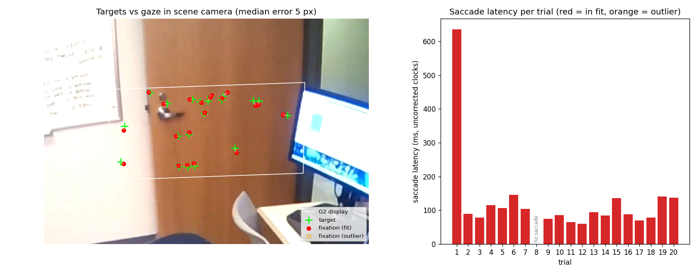
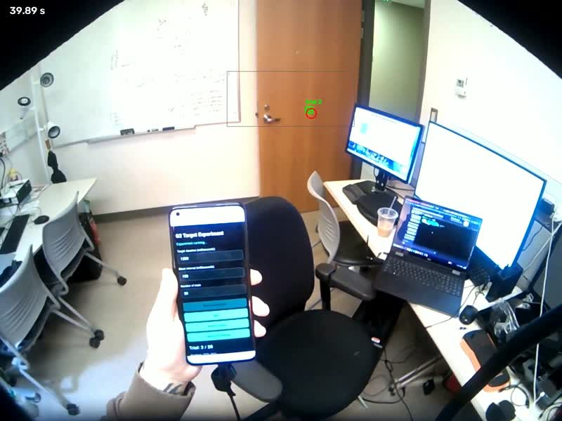

# even-g2-targets

Calibrate where the Even Realities G2 display appears in a Pupil Labs Neon scene camera.

A small Even Hub app shows a `+` target at random positions on the G2 display and logs when each one appears. You wear the Neon under the G2 and look at each target. Python scripts then match the targets to Neon saccades and fixations, fit a mapping from G2 display pixels to Neon scene camera pixels, and render plots and an overlay video.





## Layout

```
src/main.ts                  Even Hub calibration app (runs in the Even app WebView on the phone)
vite.config.ts               dev server; also saves each session to data/<session>.csv
analysis/analyze_neon_g2.py  match trials to Neon saccades/fixations, fit display -> scene mapping
analysis/plot_calibration.py summary figure (targets vs fixations, latency per trial)
analysis/make_overlay_video.py  Neon scene video with targets and gaze drawn on top
data/                        sessions and outputs (git-ignored)
docs/                        example figures
```

## Setup

Requirements: Node 22+, Python 3.10+, ffmpeg on PATH, the Even app on a phone paired with the G2, and the Neon Companion app.

```
npm install
```

```
pip install -r analysis/requirements.txt
```

## Calibrate

1. Start the dev server on the PC. The phone must be on the same network.

   ```
   npm run dev
   ```

2. Show a QR code for the dev server's **Network** address (not `localhost`), and scan it in the Even app's developer mode.

   ```
   npx evenhub qr --url http://<PC-IP>:5173
   ```

3. Wait until the status says **Connected - Ready**.
4. Start a Neon recording in the Neon Companion app.
5. Set target duration, blank interval and number of trials, then press **Start Calibration**. Look at each `+` as soon as it appears.
6. When the status says **Calibration complete - CSV saved to PC**, stop the Neon recording. The session is in `data/<session>.csv`.
7. Download the recording from Pupil Cloud as **Native Recording Data** and unzip it.

If the PC save fails, **Export CSV Backup** downloads the same data from the phone, and **Retry PC Save** sends it again.

## Analyze

Run these from the repo root. `<rec>` is the unzipped Neon recording folder.

Match trials to gaze. This finds the session in `data/` that falls inside the recording and writes `data/<session>_gaze.csv`:

```
python analysis/analyze_neon_g2.py "<rec>"
```

Summary figure, written to `data/<session>_calibration.png`:

```
python analysis/plot_calibration.py "<rec>" data/<session>_gaze.csv
```

Overlay video:

```
python analysis/make_overlay_video.py "<rec>" data/<session>_gaze.csv data/<session>_overlay.mp4
```

For long recordings you can render in chunks by adding a start and end frame. Then join the chunks with `ffmpeg -f concat`.

### Outputs

`<session>_gaze.csv` adds these columns to each trial:

| column | meaning |
|---|---|
| `onset_ns`, `offset_ns` | target on/off time (Unix ns, from the phone running the Even app) |
| `fix_start_ms`, `fix_x`, `fix_y` | longest fixation that starts while the target is shown: start time after onset, and mean position (scene camera px) |
| `latency_ms` | first saccade after onset that moves gaze at least halfway to the fitted target; empty if gaze was already on it |
| `amp_deg` | amplitude of that saccade |
| `resid_px` | distance from the fitted target position |
| `inlier` | used in the fit (residual under 3x the median) |

The fit is affine: `scene = [x, y, 1] @ M`, where `(x, y)` is the target position on the G2 display (576 x 288). The analysis script prints `M`. On the example session all 20 trials are in the fit, the R² is 1.00 for x and 0.99 for y, and the median error is 5 px.

## Notes and known issues

- **Latency is not absolute.** Target times use the clock on the phone running the Even app, and gaze uses the Neon Companion's clock. The phones are not synced, so latencies can be off by about 100 ms. The example session's median of 89 ms (some as low as 60 ms) is too fast for a real visually guided saccade. To get true latencies, send a Neon event at each onset through the Pupil Labs real-time API, or measure the clock offset between the phones.
- **No minimum latency is applied**, because with unsynced clocks a fixed cutoff throws out real responses.
- **Target position = where gaze lands on the `+`**, not the corner of the text container. The fit's intercept absorbs the glyph offset.
- **Reloading the page while the app is open** can leave the G2 refusing updates (`create 1, rebuild false`, then `rebuildPageContainer returned false`). Force-close the Even app, power-cycle the glasses and launch again. Between runs, close the app instead of reloading.
- The app is served over plain `http` on your local network, so browser APIs that need a secure page (such as `crypto.randomUUID`) are not available.
